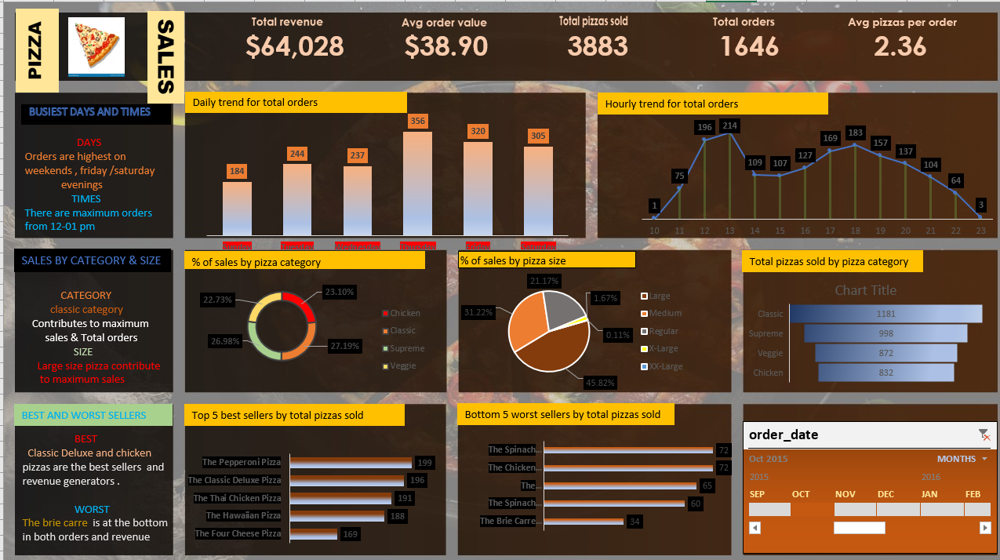

# 🍕 Pizza Sales Analysis (SQL)

Beginner-friendly SQL project that analyzes a full year of pizza restaurant sales data to answer real business questions — revenue, order trends, best/worst sellers, and more.

## 📌 Project Overview

This project uses **SQL** to explore a pizza sales dataset and calculate the key metrics (KPIs) a business owner would actually care about — how much money was made, which pizzas sell the most, and when customers order the most. It's a hands-on practice project built while learning data analysis, and it mirrors the kind of exploratory analysis done on the job.

## 🗂️ Dataset

The dataset (`pizza_sales.csv` / `pizza_sales.xlsx`) contains **48,620 rows** of pizza order data with the following columns:

| Column | Description |
|---|---|
| `pizza_id` | Unique ID for each pizza sold |
| `order_id` | ID of the order (one order can have multiple pizzas) |
| `pizza_name_id` | Short code for the pizza variant (name + size) |
| `quantity` | Number of pizzas sold in that line item |
| `order_date` | Date the order was placed |
| `order_time` | Time the order was placed |
| `unit_price` | Price of a single pizza |
| `total_price` | `quantity × unit_price` |
| `pizza_size` | Size (S, M, L, XL, XXL) |
| `pizza_category` | Category (Classic, Chicken, Veggie, Supreme) |
| `pizza_ingredients` | Ingredients used in the pizza |
| `pizza_name` | Full name of the pizza |

## 🛠️ Tools Used

- **SQL (SQL Server / T-SQL)** — all analysis and KPI queries
- **Excel** — raw data source
- *(Optional next step: Power BI / Excel dashboard on top of these queries)*

## 📊 KPIs & Questions Answered

The SQL script (`SQLQuery1.sql`) is organized into 12 numbered sections, each answering one business question:

1. **Total Revenue** — total money earned from all orders
2. **Average Order Value** — average amount spent per order
3. **Total Pizzas Sold** — total quantity sold across all orders
4. **Total Orders** — total number of distinct orders placed
5. **Average Pizzas per Order** — how many pizzas customers order on average
6. **Daily Trend** — which days of the week get the most orders
7. **Hourly Trend** — which hours of the day are busiest
8. **Sales % by Category** — revenue share of each pizza category (for January)
9. **Sales % by Size** — revenue share of each pizza size
10. **Pizzas Sold by Category** — total quantity sold per category
11. **Top 5 Best Sellers** — the 5 most popular pizzas by quantity sold
12. **Bottom 5 Worst Sellers** — the 5 least popular pizzas by quantity sold

## 💡 Key Insights (fill in your numbers)

> Run the queries and drop your actual results here — recruiters love seeing real numbers, not just query code.

- Total Revenue: `$817,860`
- Total Orders: `21,350`
- Average Order Value: `$38.30`
- Best-selling pizza: `The Classic Deluxe Pizza` (2,453 sold) — closely followed by Barbecue Chicken, Hawaiian, and Pepperoni
- Worst-selling pizza: `The Brie Carre Pizza` (490 sold)
- Busiest day: `Friday` | Busiest hour: `12 PM (lunch rush)`

- 

## 🚀 How to Run This Project

1. Download `pizza_sales.csv` (or `.xlsx`) from this repo.
2. Import it into SQL Server (or any SQL tool of your choice) as a table named `pizza_sales`.
3. Open `SQLQuery1.sql` and run the queries one by one (each section is labeled with a comment).
4. Compare your output with the insights above.

## 📁 Repo Structure

```
├── pizza_sales.csv          # Raw dataset
├── pizza_sales.xlsx         # Raw dataset (Excel version)
├── SQLQuery1.sql            # Main analysis — all 12 KPI queries
├── SQLQuery2.sql            # Quick data preview query
└── README.md                # You are here
```

## 🙋 About Me

Currently pursuing MCA and preparing for a Data Analyst role, learning SQL, Excel, Power BI, and Python. This project is part of my hands-on practice to build real-world data analysis skills.
